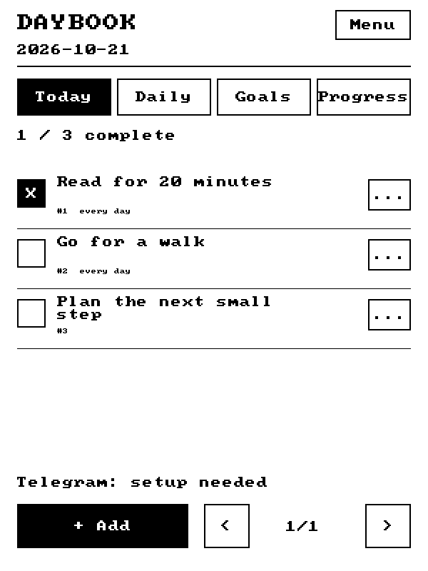
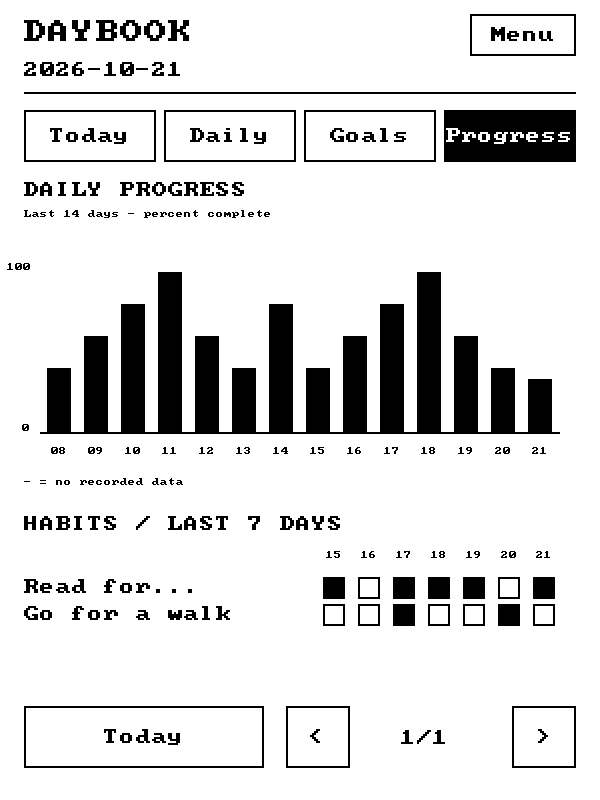
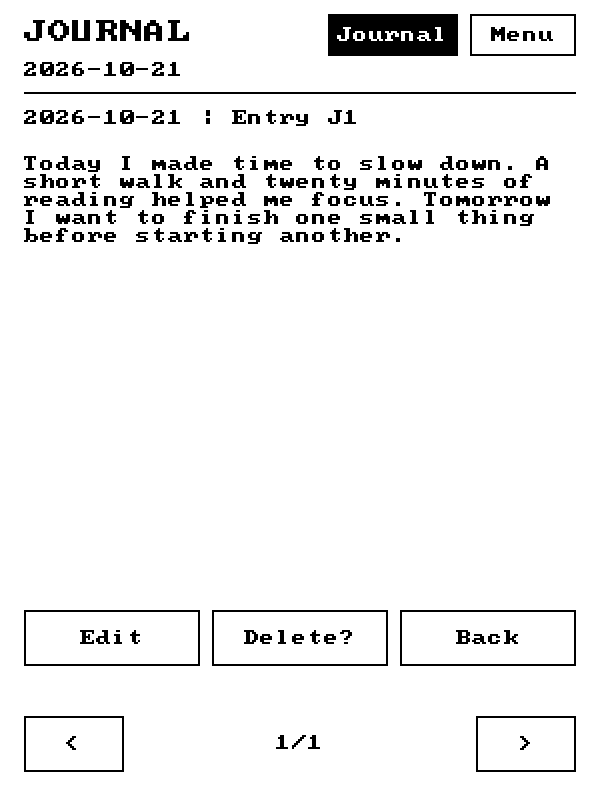
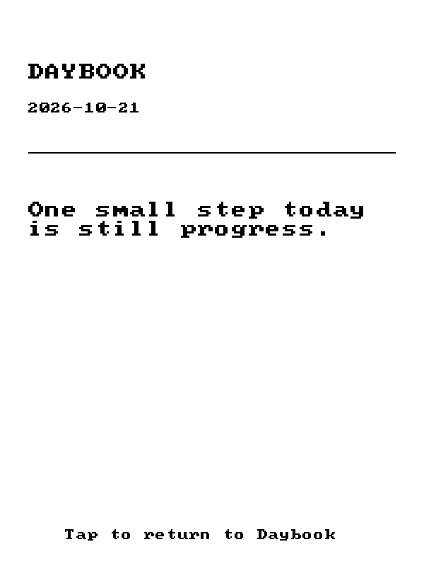

# Kindle Daybook

Turn an old Kindle into a simple place for daily tasks, monthly goals, habits, and journaling. Edit on the Kindle or send commands from your phone through Telegram.

Daybook is written in C and runs directly on a jailbroken Kindle. Once paired, it connects to Telegram itself—no always-on computer or separate server is needed.



## What it does

- **Tasks:** add, rename, complete, reopen, and delete to-dos.
- **Daily habits:** a fresh checklist each day, with completion history.
- **Monthly goals:** goals grouped by their creation month.
- **Progress:** a 14-day completion graph and a seven-day habit grid.
- **Journal:** dated entries with reading, editing, and deletion.
- **Telegram:** manage tasks and journals from a paired private bot chat.
- **Screen cover:** custom wallpaper or rotating quotes, opened manually or after five minutes idle; tap to return.
- **Local storage:** C records and strings held in memory and saved atomically to a checksummed file before screen refreshes.







These images are software previews using sample data. Photos of the real Kindle will be added later; see [the photo guide](docs/photos/README.md).

## Tested device and status

**Alpha software, tested on Kindle Basic 7th generation (2014), WP63GW / KT2, firmware 5.12.2.2, with a 600×800 screen.** Other models and firmware versions have not been verified.

On the physical Kindle, task controls and returning to Home work. Existing task data migrated to the new storage format with four tasks preserved. A journal message sent through Telegram received a reply and appeared in the running dashboard.

The quote cover and tap-to-return have also been verified on the physical Kindle. Custom wallpaper loading and the automatic idle timer have desktop test coverage; their physical-device verification is pending.

Daybook provides a custom dashboard on the existing Kindle Linux system. It does not replace the operating system or install automatic startup. Open it from the Library and use **Menu → Exit dashboard** to return Home.

## Get started

1. Read the [complete setup and user guide](docs/GUIDE.md), including the prerequisites.
2. Download the latest alpha from [Releases](https://github.com/DemiDemonDeveloper/kindle-daybook/releases).
3. Install the three application files on your already-jailbroken Kindle, then safely eject it.
4. Open **Daybook** in the Kindle Library.
5. Follow the [Telegram setup guide](docs/TELEGRAM.md) to pair your own bot.

**Keep Daybook open and Wi-Fi enabled for Telegram sync.** It checks roughly every 30 seconds. Exit before connecting USB.

## Telegram examples

```text
/add Buy groceries
/daily Read for 20 minutes
/goal Finish my portfolio
/list
/done 3
/edit 3 Read for 30 minutes
/delete 3
/journal Today I made time for reading.
```

Task IDs appear in `/list`. Use `/help` for commands, or see the [command reference](docs/GUIDE.md#telegram-command-reference).

## Documentation

| Guide | Contents |
| --- | --- |
| [Setup and user guide](docs/GUIDE.md) | Installation, everyday use, commands, backups, troubleshooting |
| [Installation details](docs/INSTALL.md) | Source installation, launcher behavior, recovery |
| [Telegram setup](docs/TELEGRAM.md) | Bot creation, private pairing, sync behavior |
| [Architecture](docs/ARCHITECTURE.md) | C application, storage, rendering, and transport |
| [Wallpaper and quotes](docs/COVER.md) | Screen cover, custom images, quotes, and idle settings |
| [Adding photos](docs/photos/README.md) | Where to put real-device pictures and how to show them here |

## Build and test

Requirements: a C compiler, Make, Python 3, and Zig 0.17.0 for the Kindle cross-build.

```sh
git clone https://github.com/DemiDemonDeveloper/kindle-daybook.git
cd kindle-daybook
make test host
python3 tests/test_sync.py
ZIG=/path/to/zig make kindle
```

The Kindle build is a statically linked `arm-linux-musleabi` executable for Cortex-A9. Output is in `dist/`. FBInk must already be installed on the Kindle and is not bundled.

Desktop preview with sample data:

```sh
./build/daybook-host --data build/preview-data --demo --snapshot build/preview.pgm
```

Tests cover task behavior, journal commands, touch controls, storage migration and corruption detection, Telegram ownership and replay protection, the curl transport, and launcher cleanup. GitHub Actions runs the desktop checks.

## Current limits

- Up to 256 tasks and 128 journal entries; each journal entry holds up to 2048 bytes.
- Up to 90 completion dates per habit and 90 daily progress snapshots.
- The display font and touch keyboard use ASCII. Other characters are stored but shown as `?`.
- The dashboard stays awake while active. Wi-Fi and an active dashboard affect battery life.
- Telegram sync stops when Daybook is closed or offline. Incoming Telegram updates are retained for up to 24 hours.
- WhatsApp, reminders, automatic startup, and arbitrary natural-language dates are not implemented.

Tasks, journals, and bot settings are stored locally without encryption. Keep `daybook/data` and backups private. Tokens and runtime data are excluded from Git; never attach them to an issue or photograph them.

## Development

Features will evolve through use on the device. Bug reports are most useful with the Kindle model, firmware, steps to reproduce, and a description of what happened. Review logs before sharing them and remove personal information. Please keep credentials and journal contents out of issues.

## License

Original code is [MIT licensed](LICENSE). cJSON 1.7.19 is MIT licensed and the font8x8 basic font is public domain; their notices are retained in `vendor/`. FBInk is a separately installed dependency.
