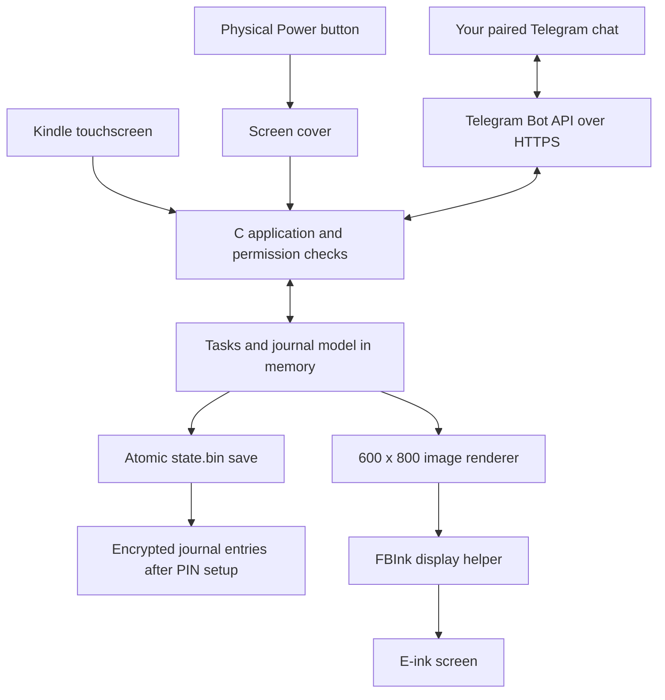

# How Kindle Daybook was created

Daybook is a small C application that gives an old Kindle a new purpose: tasks, habits, goals, progress graphs, and journaling, with Telegram control.

The Kindle's original Linux system still runs underneath. The jailbreak allows the custom launcher and executable to run. Daybook draws its own interface and returns control to the normal Kindle interface when you exit.

## The main pieces

The touchscreen and Telegram both reach the same task rules. This avoids maintaining two separate implementations of add, edit, complete, or delete.

## 1. Establish what the Kindle can run

We identified the device as a Kindle Basic 7th generation, WP63GW / KT2, on firmware 5.12.2.2. It has an ARM processor and a 600×800 screen.

After jailbreaking, we checked that custom scripts could run, that the touchscreen was accessible, and that FBInk was available to refresh the e-ink display. These checks established the pieces needed for a native dashboard.

Automatic startup has not been installed. A Library document launches the app manually, which also gives us a recovery route while developing it.

## 2. Build the app on the computer

The source is C. C gives this small application direct access to Linux input devices and keeps the executable compact.

The Mac and Kindle use different machine-code targets. We use Zig as a **cross-compiler**: it takes the C source on the Mac and produces an ARM Linux executable for the Kindle. The musl C runtime and libsodium are linked into that executable. FBInk and curl are already available on the tested Kindle.

The build also produces a desktop executable. It can draw previews and exercise the same model without repeatedly transferring files to the Kindle.

See [the build script](../scripts/build-kindle.sh) and [Makefile](../Makefile).

## 3. Define the information before drawing it

The **model** is the application's information and rules. A task has a stable ID, title, kind, and completion information. Daily habits retain completion dates; goals belong to their creation month. Journal entries have their own IDs, dates, and text.

The rules determine what appears today, when habits become available again, and what belongs in the current month's goals. The app also retains progress snapshots for the graph and habit grid.

Start with [model.h](../src/model.h) to see the data structures, then [model.c](../src/model.c) to see the rules and command handling.

## 4. Draw an e-ink interface

The renderer creates a 600×800 grayscale image in memory. It draws rectangles, text from a small bitmap font, checkboxes, graphs, and buttons. FBInk sends the generated image to the Kindle's display.

A refresh happens when the interface needs to change. The program does not redraw continuously like a video. Screen images use temporary system storage and are removed after use.

Custom wallpaper is converted to the same grayscale dimensions. Quote mode draws text through the same renderer.

See the drawing functions in [daybook.c](../src/daybook.c) and [the wallpaper helper](../scripts/prepare-wallpaper.py).

## 5. Turn taps and button presses into actions

Linux provides input events with coordinates, key codes, and press/release values. The application reads the touchscreen, maps its coordinates to the 600×800 interface, and checks which control was touched.

The Power button is a separate input device on the tested Kindle. A diagnostic confirmed physical KEY_POWER events on `max77696-onkey`. A complete short press toggles the dashboard cover. Covered touches cannot dismiss it. Input filtering rejects held/repeated button events and touch gestures that began around unlocking.

The dashboard cover and journal PIN are separate. Power can uncover the dashboard while past journal entries remain PIN-locked.

## 6. Keep the live state in memory and save safely

Daybook reads the saved state at startup and keeps the working model in RAM. Screen updates use that model rather than rereading the task file.

Saves write a temporary file, flush it, and rename it over the previous file. This **atomic replacement** reduces the risk of leaving half a save if writing is interrupted. Record lengths, format markers, and checksums help reject damaged input.

The initial version used JSON task files. It evolved to explicit binary records and C strings, with a migration path for existing data. JSON remains useful for Telegram's protocol and bot configuration.

See [store.c](../src/store.c). Protected journals add the envelope implemented in [vault.c](../src/vault.c).

## 7. Add Telegram as another controller

BotFather creates the bot account and token. The local setup helper verifies the bot and pairs one private chat using a random message.

While Daybook is open with Wi-Fi enabled, the Kindle checks Telegram roughly every 30 seconds. A message such as `/done 3` becomes a command to the same model used by the touchscreen. The app saves the result and sends a reply.

Applied update IDs are saved with state, preventing a repeated Telegram update from applying the same command twice. Network transfers run in child processes so they do not normally block touch handling. The Mac is needed for setup and development, not for everyday bot communication.

See [Telegram setup](TELEGRAM.md).

## 8. Protect past journal entries while allowing new ones

This required more than putting a PIN screen in front of plain text.

Each journal entry is encrypted using a public key. Anyone allowed to add can use that public key to seal a new entry; they do not need the private key that reads it. This is why locked writing can remain available.

The private key is itself encrypted under a key derived from the journal PIN using Argon2id. Unlocking on the Kindle temporarily makes earlier entries available. Locking clears the private key and decrypted journal text from the active model. Past-entry requests from Telegram follow the same lock state; the PIN is not sent through Telegram.

We use libsodium's encryption primitives. The detailed design, recovery limits, and treatment of old backups and Telegram history are explained in [Journal privacy](JOURNAL-LOCK.md).

## 9. Make launching and exiting reliable

The Library launcher starts a supervisor script. The supervisor preserves the screen, pauses the stock window manager, and starts Daybook. On exit, it restores the display and resumes the stock interface.

Earlier experiments stopped and restarted the whole framework. Physical testing exposed freezes, so the launcher was changed to preserve the running framework. That is an example of the device tests shaping the implementation.

See [Daybook.sh](../scripts/Daybook.sh) and [run-dashboard.sh](../scripts/run-dashboard.sh).

## 10. Test, install, and publish

We developed incrementally: task controls, habits and graphs, journal entries, Telegram, screen covers, journal privacy, and button-only unlocking.

Automated tests check model rules, persistence, duplicate messages, permissions, encryption, wrong PINs, locked additions, touch handling, and launcher cleanup. The ARM cross-build checks that the application compiles for the Kindle. Physical tests verify what compilation cannot establish: the actual display, touchscreen, button, Wi-Fi, and return to Home.

The installer backs up an existing installation, copies the executable and launchers, and verifies their hashes. GitHub stores source, tests, guides, and sample previews. Releases contain installable files and checksums. Private bot settings, saved tasks, and journal data stay out of those uploads.

## A useful order for exploring the code

1. Read `src/model.h` to learn what is stored.
2. Follow one command, such as `/add`, through `src/model.c`.
3. Find `app_command()` and `touch()` in `src/daybook.c` to see how inputs reach the model.
4. Read `render()` to connect model data with what you see on screen.
5. Read `src/store.c` for persistence, then `src/vault.c` for journal encryption.
6. Look at the matching tests in `tests/` to see the expected behavior.

Following one action from input to save to redraw is a manageable way to understand the whole application.
